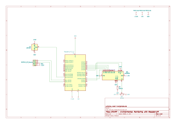

# EMWRP — Environmental Monitoring with Raspberry Pi

An IoT environmental monitoring platform built on a Raspberry Pi. It acquires real-time temperature, relative humidity, barometric pressure, and SoC thermal telemetry, logs measurements to a PostgreSQL time-series database with outlier filtering, displays live readings on a local 16x2 character LCD, and serves an interactive Plotly Dash web dashboard alongside a Flask REST API.


---

## Key Features

* **Multi-Sensor Acquisition:** Reads barometric pressure and ambient temperature over I2C (`BMP3XX`), relative humidity via `DHT22` `BMP180`, and Raspberry Pi CPU temperature via `gpiozero`.
* **Intelligent Data Logging:** Filters transient humidity spikes (`> 15%` step change).
* **Thread-Safe Database Layer:** Uses `psycopg2`'s `ThreadedConnectionPool`, `RealDictCursor`, and parameterized SQL queries for safe concurrent access across Flask and Dash workers.
* **Interactive Multi-Page Dashboard:**
  * **Home (`/`):** Live numeric readout refreshed every 30 seconds.
  * **Live (`/live`):** Rolling 24-hour multi-axis time-series plots for temperature, humidity, and pressure.
  * **Analysis (`/analysis`):** Interactive date-range picker for historical telemetry inspection.
* **REST API:** Lightweight JSON endpoint (`/lastMeasurement`) for external integrations or mobile clients.
* **Local Readout & Linux Daemons:** Optional 16x2 HD44780 LCD driver and non-root `systemd` unit files with automatic restart and PostgreSQL dependency ordering.

---

## Hardware Schematic & Wiring




---

## Setup & Installation

### 1. Database Initialization (PostgreSQL)

Create the database, dedicated user, and `sensor_data` table:

```sql
CREATE DATABASE raspi;
CREATE USER emwrp_user WITH PASSWORD 'your_secure_password';
GRANT ALL PRIVILEGES ON DATABASE raspi TO emwrp_user;

\c raspi

CREATE TABLE sensor_data (
    id SERIAL PRIMARY KEY,
    temp REAL NOT NULL,
    hum REAL NOT NULL,
    datetime TIMESTAMP DEFAULT CURRENT_TIMESTAMP,
    pressure REAL NOT NULL,
    cputemp REAL NOT NULL
);

GRANT ALL PRIVILEGES ON TABLE sensor_data TO emwrp_user;
GRANT USAGE, SELECT ON SEQUENCE sensor_data_id_seq TO emwrp_user;
```

### 2. Python Environment & Configuration

```bash
git clone https://github.com/<your-username>/EMWRP.git
cd EMWRP

python3 -m venv .venv
source .venv/bin/activate
pip install -r requirements.txt

cp .env.example .env
# Edit .env with your PostgreSQL credentials and host
```

### 3. Enable Hardware Services on Raspberry Pi

Add your user to the `gpio` and `i2c` groups so the daemons run without root privileges, then install the `systemd` units:

```bash
sudo usermod -aG gpio,i2c $USER
sudo cp systemd/emwrp-logger.service /etc/systemd/system/
sudo cp systemd/emwrp-lcd.service /etc/systemd/system/   # Optional: only if LCD is attached

sudo systemctl daemon-reload
sudo systemctl enable --now emwrp-logger.service
sudo systemctl enable --now emwrp-lcd.service
```

### 4. Run the Web Dashboard & API

For local development:
```bash
python3 -m emwrp.app
```

For production (using Gunicorn with `wsgi.py`):
```bash
gunicorn --bind 0.0.0.0:7000 --workers 2 --threads 4 wsgi:application
```

---

## REST API Reference

### `GET /lastMeasurement`

Returns the most recent sensor reading stored in PostgreSQL.

**Response (`200 OK`):**
```json
{
  "Package": [
    { "Item": "Temperature", "Value": 23.4 },
    { "Item": "Humidity", "Value": 48.2 },
    { "Item": "Pressure", "Value": 1013.2 },
    { "Item": "cpuTemperature", "Value": 46.8 }
  ]
}
```

Returns `404 Not Found` if no measurements have been logged yet.

---

## Author

**Lampros-Iason Evangelopoulos**